# Provision source database

## Introduction

Estimated Time: 20 minutes

### Objectives

In this lab

* You will configure a Virtual Cloud Network in Oracle Cloud Infrastructure.
* You will create a Subnet in the Virtual Cloud Network.
* You will provision source database using Oracle Marketplace image available in Oracle Cloud Infrastructure.

### Prerequisites

* All previous labs have been successfully completed.

## Task 1 : Confgure Virtual Cloud Network and Subnet

In this task you will create a new Virtual Cloud Network , create a private subnet inside the VCN and also configure it . You will use this later to host source database compute , target database system and ZDM service host.

1. Login to your Oracle Cloud Console.

2. Create Virtual Cloud Network.

   Select the **Navigation Menu** in the upper left, navigate to **Networking** and then select **Virtual Cloud Networks**.
   
   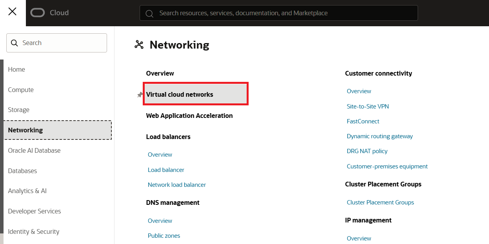
 
   On the new window (as seen below) select **Create VCN** to bring up **Create a Virtual Cloud Network** window.

   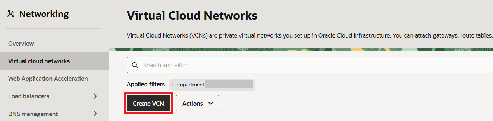

   Enter below details on the **Create a Virtual Cloud Network** window and select **Create VCN** to initiate VCN creation.

   Name: zdm-vcn
   
   IPv4 CIDR Block: 10.20.17.0/24

   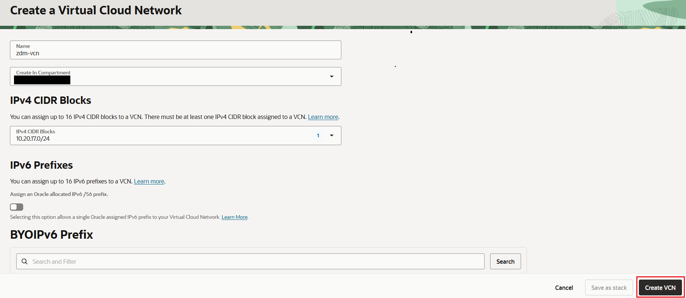
   

3. Create Subnet.

   Navigate to **Subnets** under new VCN and select **Create Subnet** 

   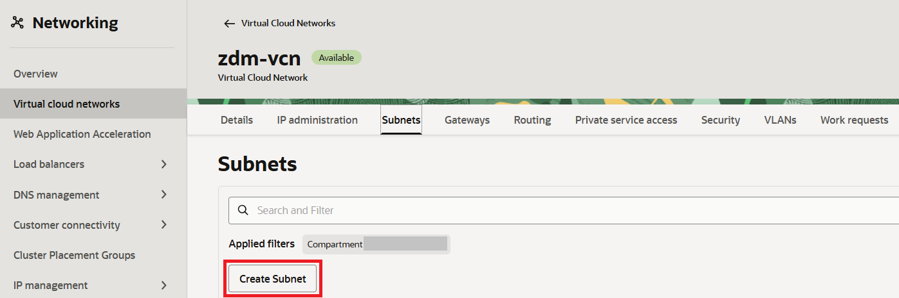

   Provide below details on the **Create Subnet** window

   Name: zdm-vcn-priv
   
   IPv4 CIDR Block: 10.20.17.0/24

   Select Default for Route Table , DHCP options and Security list.

   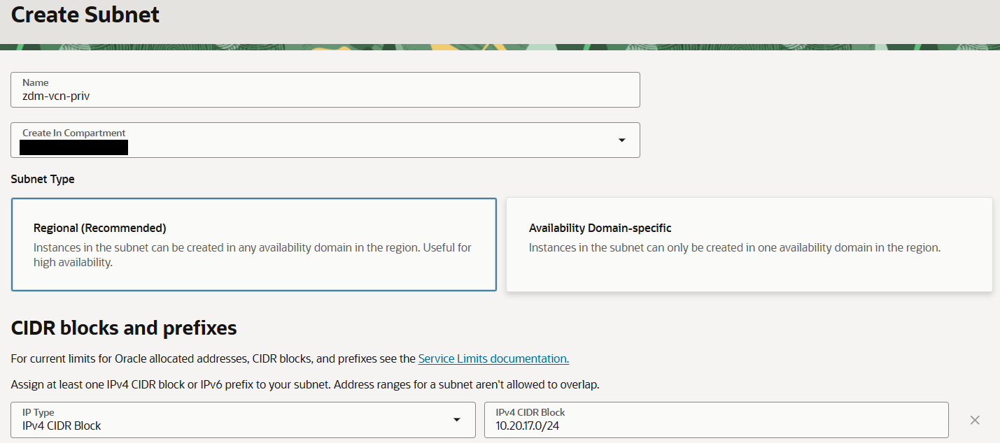
   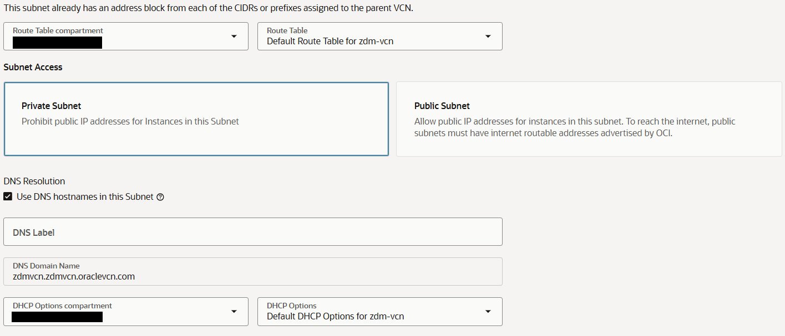
   

   Select **Create Subnet** once the required detailed are provided.

4. Create Servive Gateway 

   Navigate to **Gateways** under new VCN and select **Create Service Gateway** under **Service Gateways**.

   

   On **Create Service Gateway** screen , enter below details

   Name: **zdm-vcn-sg**

   Services: All <Region ID> Services in Oracle Services Network

   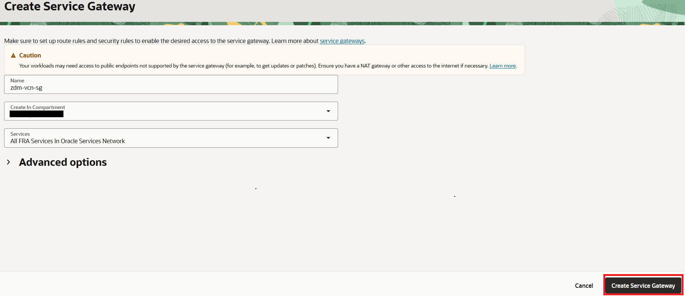

   Select **Create Service Gateway** to proceed with service gateway creation.

5. Configure Route

   Navigate to **Routing** under new VCN and select **Default Route Table for zdm-vcn**.

     

   Enter below details On the **Add Route Rules** window
   
   Target Type: Service Gateway

   Destinaton Service: All <Region ID> Services in Oracle Services Network.

   Compartnet: Select the same compartment as the Service Gateway created earlier.

   Target Service Gateway: Select Service Gateway created in earlier step.

     

   Select **Add Route Rules** to add routes.

 

## Task 2 : Provision Source Database

1. Login to your Oracle Cloud Console.

2. Click the **Navigation Menu** in the upper left, navigate to **Marketplace** and then select **All Applications**.

   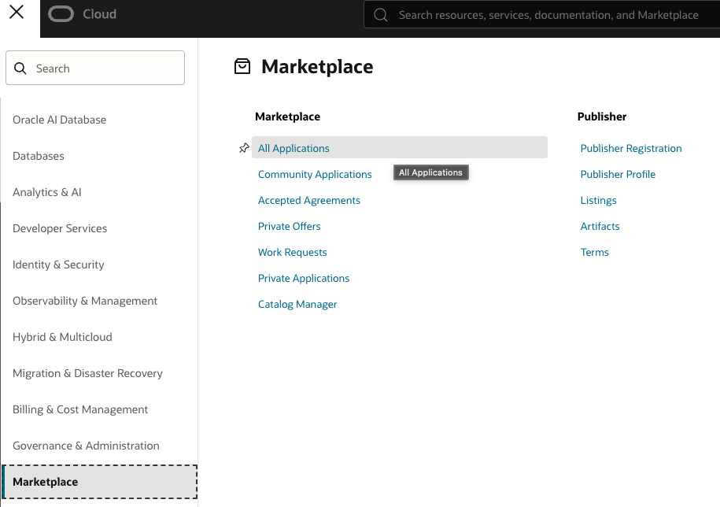

3. Type **Oracle Database** in search bar and press Enter.

   

4. Click on the listed **Oracle Database** Image.

   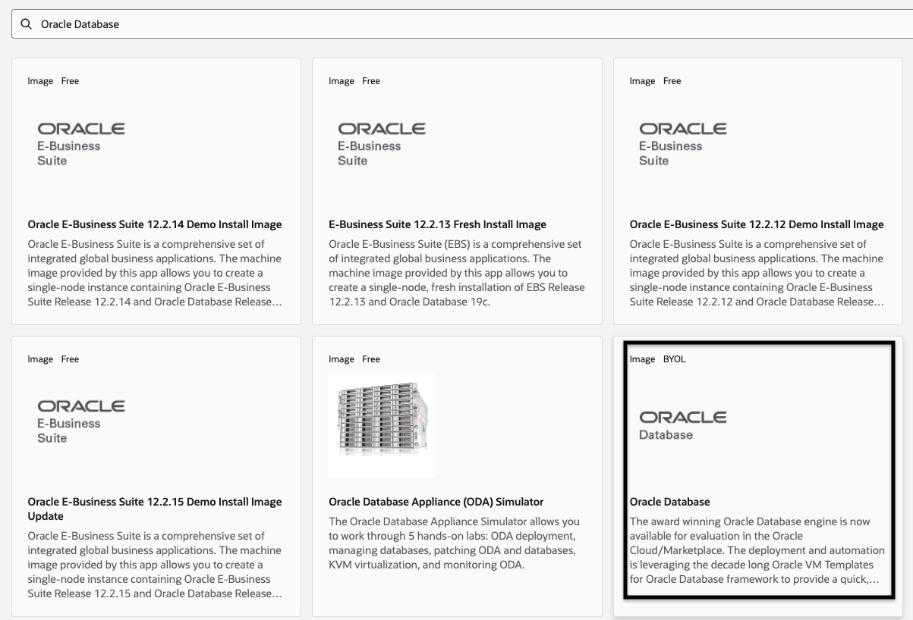

5. Click on Launch Instance.
  
   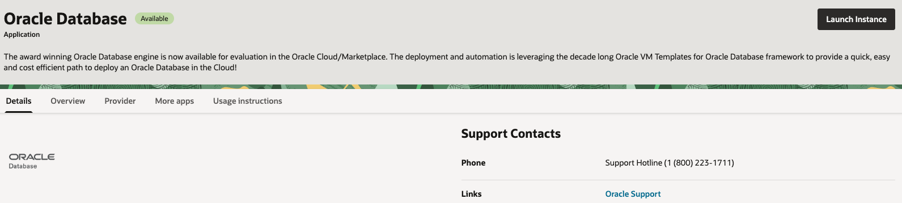

6. Select a Database image 

   There will be multiple options including choice of OS.
    
   Please choose latest 19c database version on Oracle Linux 8 since your Target DB system will be on Oracle Linux 8 for this lab.

   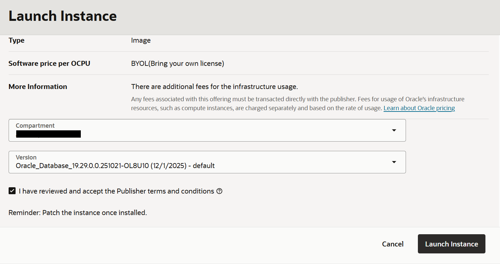

   Please make a note of the exact DB version with Release Update since it will be required in next Lab.

   Ensure to select the correct compartment in your tenancy , accept the agreement  and then click on **Launch Instance**.

7. On the **Create compute instance** page , update **Name** as **zdm-source-db**.

   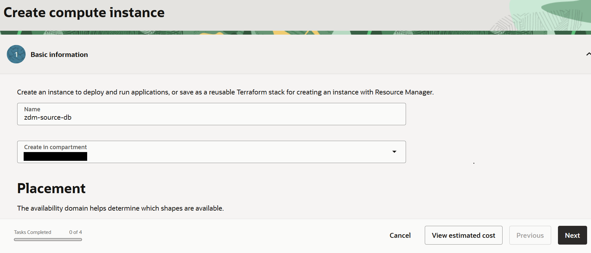

   You can leave the Placement , Image  and shape to default .

   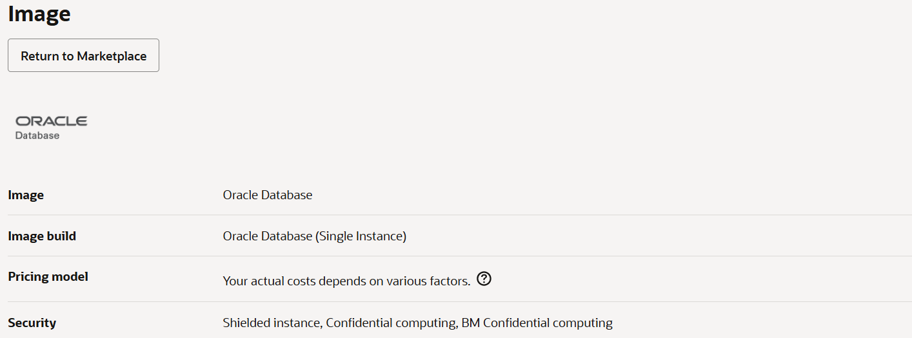

   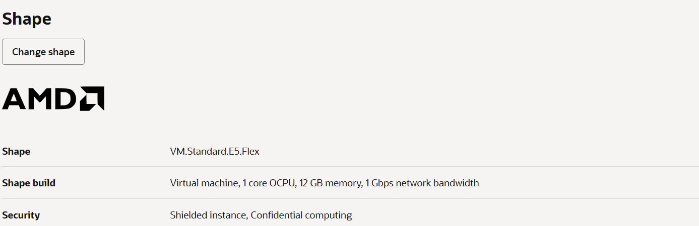

   Proceed to **Security** by selecting **Next**

8. Leave all **Security** parameters to default and proceed to **Networking** by selecting **Next**

   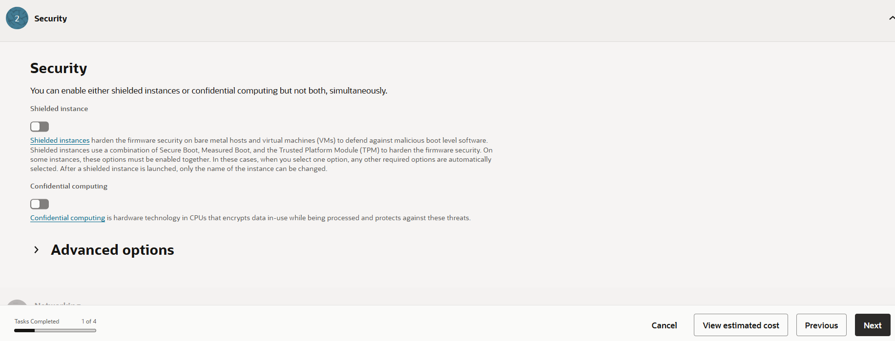

9. On the Networking page , select the VCN and subnet created earlier in the lab.

   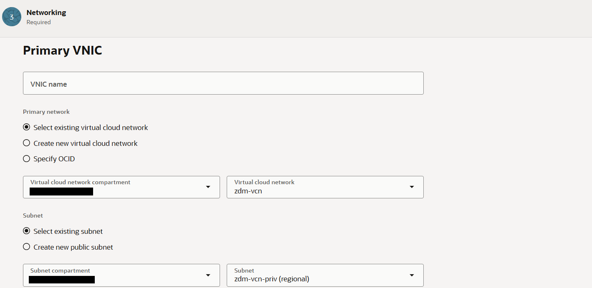

   You can leave the remaining selection with the default values.

   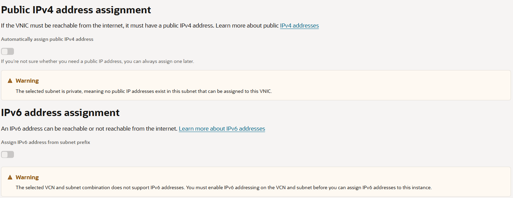
   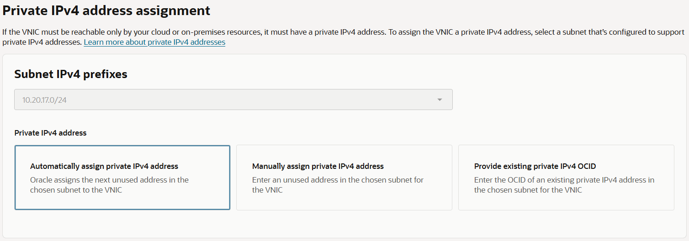

10. Under **Add SSH keys**.

     Browse and provide the public ssh key generated in Lab 1.

     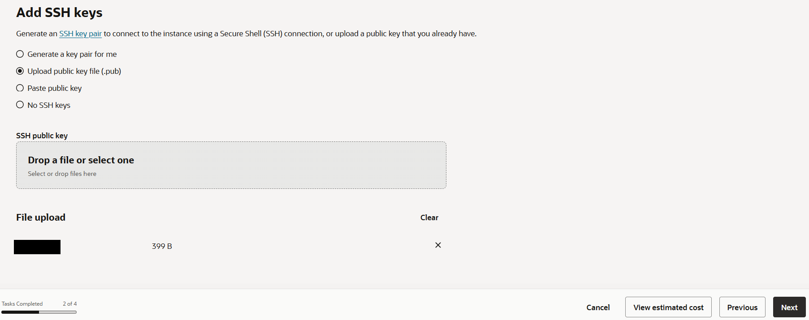

     Select **Next** to proceed to Storage.

11. Leave the **Storage** parameters to default and proceed to review by selecting **Next**.

    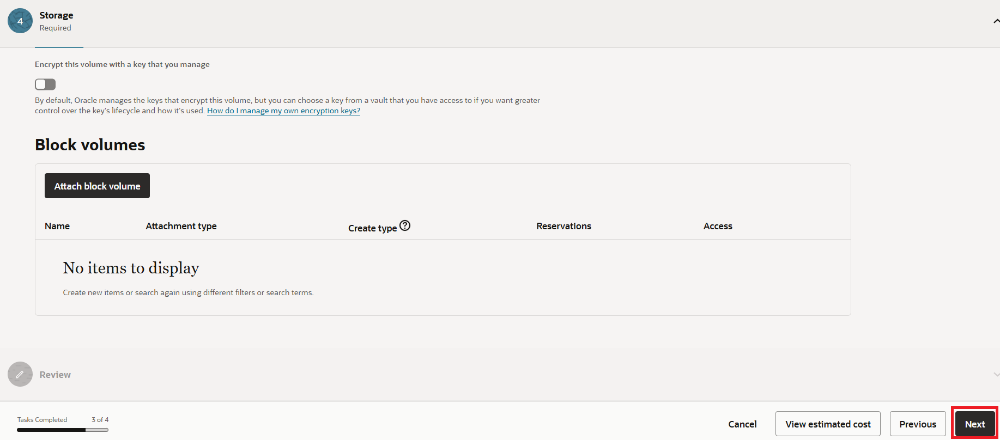

12. Review the details and select **Create** to start the provisioning of source database.

    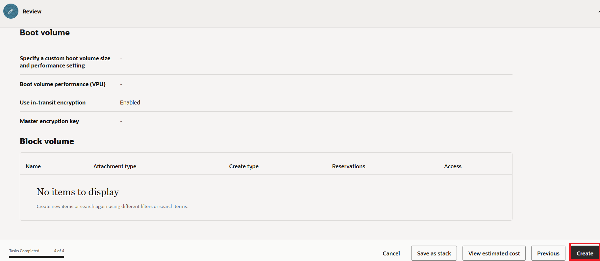

13. In few minutes , compute instance with database will be provisioned and running as below.
   
    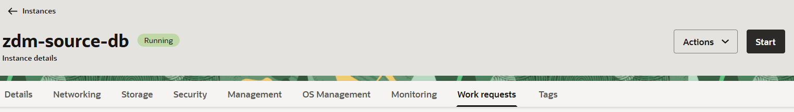

14. Note down the private IP of compute instance.

     Click the **Navigation Menu** in the upper left, navigate to **Compute** and then select **Instances**.

     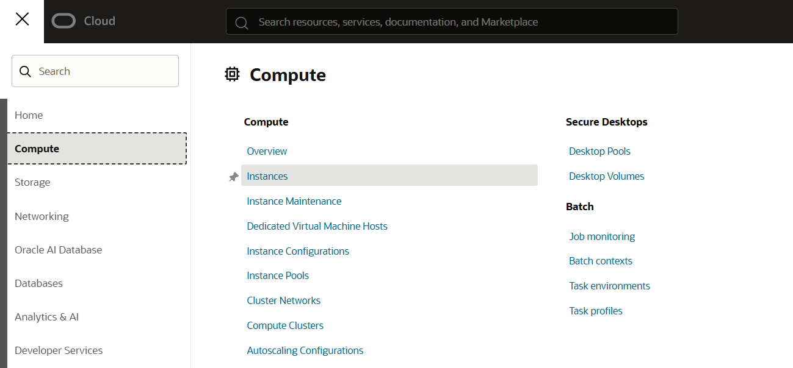

     Make a note of the privte IP of the source database compute.

     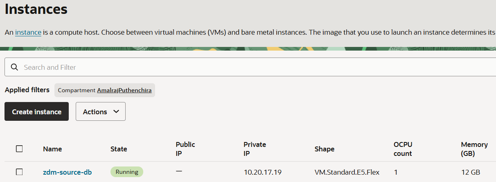

15. Collect the value of SYS password.

    Login to the source database server using the private IP and private ssh key.

    Please refer the value of RACPASSWORD variable in file /u01/ocidb/params.ini for SYS,SYSTEM,PDBADMIN and SYSMAN password.

    
    
You may now **proceed to the next lab**.

## Acknowledgements
* **Author** - Amalraj Puthenchira, Data Modernisation Black Belt, EMEA Technology Cloud Engineering
* **Last Updated By/Date** - Amalraj Puthenchira, November 2026

