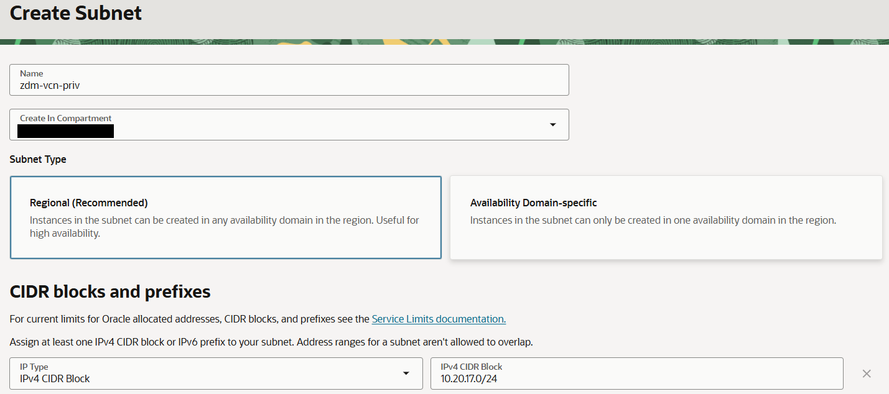

# Provision source database

## Introduction

Estimated Time: 20 minutes

### Objectives

In this lab

* You will configure a Virtual Cloud Network in Oracle Cloud Infrastructure.
* You will provision source database using Oracle Marketplace image available in Oracle Cloud Infrastructure.

### Prerequisites

* All previous labs have been successfully completed.

## Task 1 : Confgure Virtual Cloud Network

In this task you will create a new Virtual Cloud Network and configure it . You will use this later to host source database compute , target database system and ZDM service host.

1. Login to your Oracle Cloud Console.

2. Click the **Navigation Menu** in the upper left, navigate to **Networking** and then select **Virtual Cloud Networks**.
   
   
 
3. Select **Create VCN** to bring up Create VCN window.

   

4. Enter below details on the new window and select **Create VCN** to initiate VCN creation.

   Name: zdm-vcn
   
   IPv4 CIDR Block: 10.20.17.0/24

   
   

5. Navigate to **Subnets** under new VCN and select **Create Subnet** 

   

6. Provide below details on the new screen.

   Name: zdm-vcn-priv
   
   IPv4 CIDR Block: 10.20.17.0/24

   Select Default for Route Table , DHCP options and Security list.

   
   
   

   Once details are entered , click on **Create Subnet**.

7. Navigate to **Gateways** under new VCN and select **Create Service Gateway** under Service Gateway.

   

8. On **Create Service Gateway** screen , enter below details

   Name: zdm-vcn-sg

   Services: All <Region ID> Services in Oracle Services Network

   

   Select **Create Service Gateway** to proceed with service gateway creation.

## Task 2 : Provision Source Database

1. Login to your Oracle Cloud Console.

2. Click the **Navigation Menu** in the upper left, navigate to **Marketplace** and then select **All Applications**.

   

3. Type **Oracle Database** in search bar.

   

4. Click on the listed **Oracle Database** Image.

   

5. Click on Launch Instance.
  
   

6. Select an Image (There will be multiple options including choice of OS).
    
   Please choose latest 19c database version on Oracle Linux 8 since your Target DB system will be on Oracle Linux 8 for this lab.

   

   Please make a note of the exact OS and DB version with Release Update since it will be required in next Lab.

   Ensure to select the correct compartment in your tenancy , accept the agreement  and then click on **Launch Instance**.

7. On the **Create compute instance** page , update **Name** as **zdm-source-db**.

   

   You can leave the Placement , Image  and shape to default .

   

   

   Proceed to Security by selecting **Next**

8. Leave all security parameters to default and Proceed to Networking by selecting **Next**

   

9. On the Networking page , select the VCN created earlier in the lab and also select the subnet.

   

   You can leave the remaining selection with the default values.

   
   

10. Under **Add SSH keys**.

     Browse and provide the public ssh key generated in Lab 1.

     

     Click Next to proceed to Storage.

11. Leave the Storage parameters to default and Proceed to review by selecting **Next**.

    

12. Review the detail and click on **Create** to start the provisioning.

    

13. In few minutes , compute instance with database will be provisioned and running as below.
   
    

14. Take a note of the private IP address of the compute instance which will used to login to source database system.

15. Collect the value of SYS password.

    Login to the source database server using the private IP and private ssh key.

    Please refer the value of RACPASSWORD variable in file /u01/ocidb/params.ini for SYS,SYSTEM,PDBADMIN and SYSMAN password.

    
    
You may now **proceed to the next lab**.

## Acknowledgements
* **Author** - Amalraj Puthenchira, Data Modernisation Black Belt, EMEA Technology Cloud Engineering
* **Last Updated By/Date** - Amalraj Puthenchira, November 2026

