# Provision target database

## Introduction

Oracle Zero Downtime Migration requires you to create a placeholder target database before the start of the migration to the target environment. 

The placeholder target database gets overwritten with the source database files during migration.

Please note as of Zero Downtime Migration Release 21.3 , only Grid Infrastructure-based database services are supported as targets. For example, an LVM-based instance or an instance created in compute node without Grid Infrastructure are not supported targets.

You should use the recommended console/commandline/APIs for creation of a target placeholder database.

Estimated Time: 30 minutes

### Objectives

In this lab

* You will collect information from the source database required for target database provisioning.

* You will prepare a database software image for the target database.

* You will provision an Oracle Base Database System to use as the target database system.

### Prerequisites

* All previous labs have been successfully completed.

## Task 1 : Collect source database details

1. Check the Operating System version of the source database.

   For this lab you have deployed source database on Oracle Linux 8.

   You can use this lab with your source database as well , however ensure that the Operating System is Linux.

2. Establish connection to source database.

   Please follow below steps to establish connection to source database using SQL*PLUS.

   Login to source database compute using private IP and ssh key (generated in Lab 1)

   Username to login : **opc** 

   Switch user to **oracle** using below command.

   **sudo su - oracle**

   Set the environment to connect to your database.

   Type **. oraenv** and press **Enter**. 
    
   Press Enter when asked for **ORACLE\_SID** (Enter your ORACLE\_SID in case if it is different).

   Type **sqlplus "/as sysdba"**  and press **Enter** to connect to source database as SYS user.

   Please find below snippet of the connection steps.

   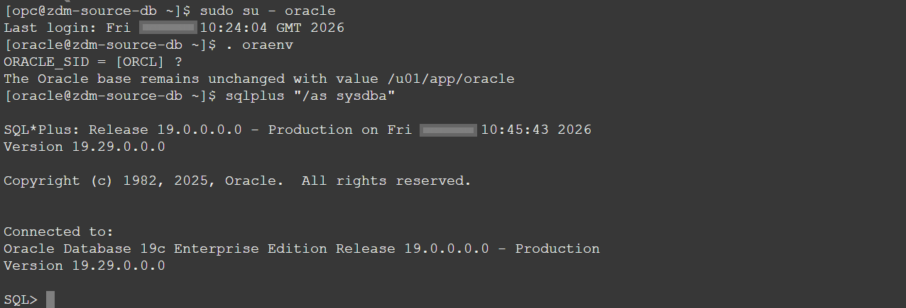

3. Check the database edition.

   The source database provisioned earlier in lab 2 is an **Enterprise Edition** database since the Oracle Marketplace Image used for source database provisioning creates an Enterprise Edition database.

   In case you would like know the database edition for your on-premises database then refer the below steps.

   Execute the below query after connecting to source database using connection established in step 2.

    ```console
    <copy>
    select banner from v$version;
    </copy>
    ```
   
   You will receive an output similar to the one below which shows the Database Edition.

   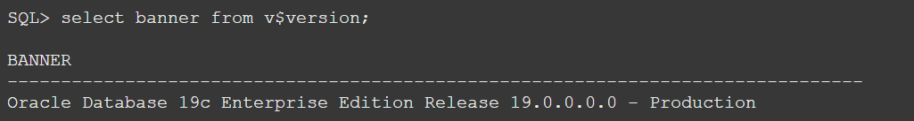

4. Check database characterset.
   
   Execute the below query after connecting to source database using connection established in step 2.
     
    ```console
    <copy>
    col parameter for a40
    col value for a30
    select PARAMETER,VALUE from nls_database_parameters where parameter like '%NLS%CHARACTERSET';
    </copy>
    ```
   
   In the query output **NLS\_CHARACTERSET** is the database characterset and **NLS\_NCHAR\_CHARACTERSET** is the national characterset.

   Sample output is shown below.

   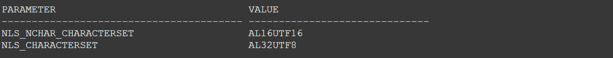

5. Check encryption algorithm.

   Check the **$ORACLE\_HOME\network\admin\sqlnet.ora** file in source database server to identify any encryption algorithm mentioned.

6. Generate patch inventory output.

   Execute below steps after logged into the source database system.

   Switch user to **oracle** using below command.

   **sudo su - oracle**

   Execute **opatch lsinventory** command.

   Below is sample trimmed output of the above command.

   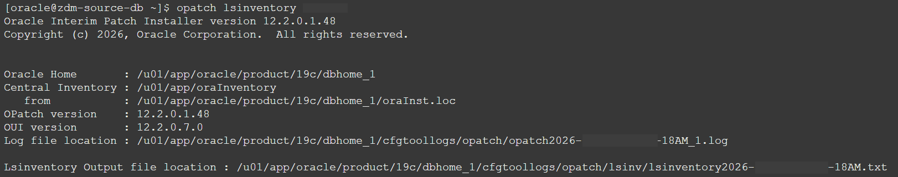

   Download the Lsinventory output file (location is shown in the output) to local desktop.


## Task 2 : Prepare database software image for target database

1. Navigate to Oracle Base Database Service.

   Click the **navigation menu** in the upper left, navigate to **Oracle AI Database** and then select **Oracle Base Database Service**.

   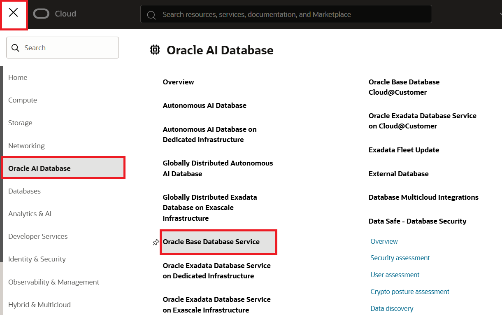

2. Select **Software images** on the left hand side of new screen.

   Select the appropriate compartment and then click on **Create software image** under **Software Images**.

   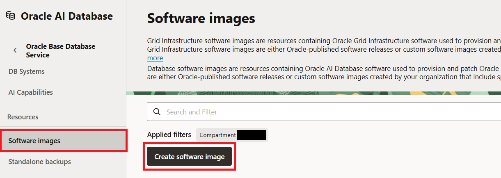

3. Make below selections on the **Create software image** page.

   Image Type: **Database Software image**

   Display name: **DBImage-19c**

   Compartment: Compartment of your choice

      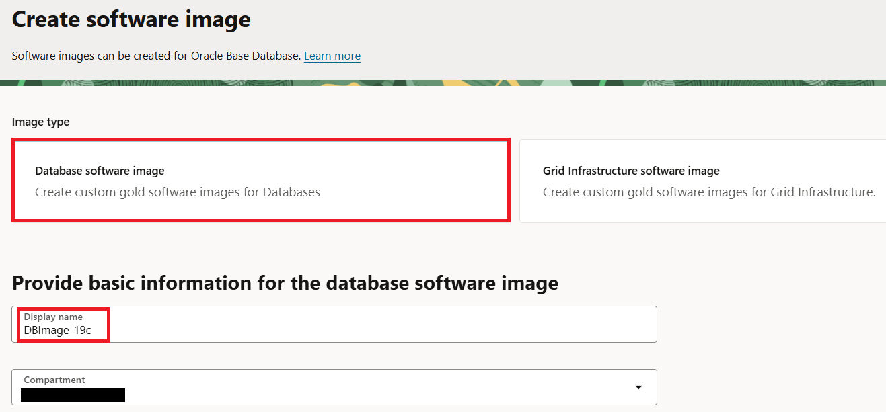

4. Make changes as below to configure database software image.

   Database version: 19c (same as the major version of your source database).

   Database Version Release Update: **19.32.0.0.0** ( Please ensure that you are selecting a version which is same or higher version than source database).

   one-off patches : Specify the one-off patches applicable on the target database home. You can leave it null for this Lab since there are no specific one-off patches applied on source database.

   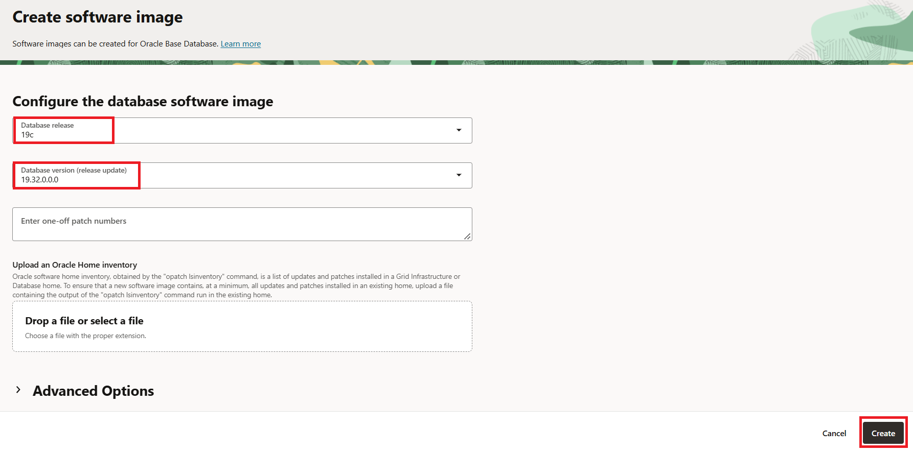

   Select **Create** to proceed with image creation.

   You may get a new screen asking you to confirm the risk of going with database version which is N-1 where N is the latest RU.

   Please wait for the completion of this task before proceeding to the next task.
   
## Task 3 : Provision target database

1. Navigate to Oracle Base Database service.

   Click the **Navigation Menu** in the upper left, navigate to **Oracle AI Database** and then select **Oracle Base Database service** as shown below.

   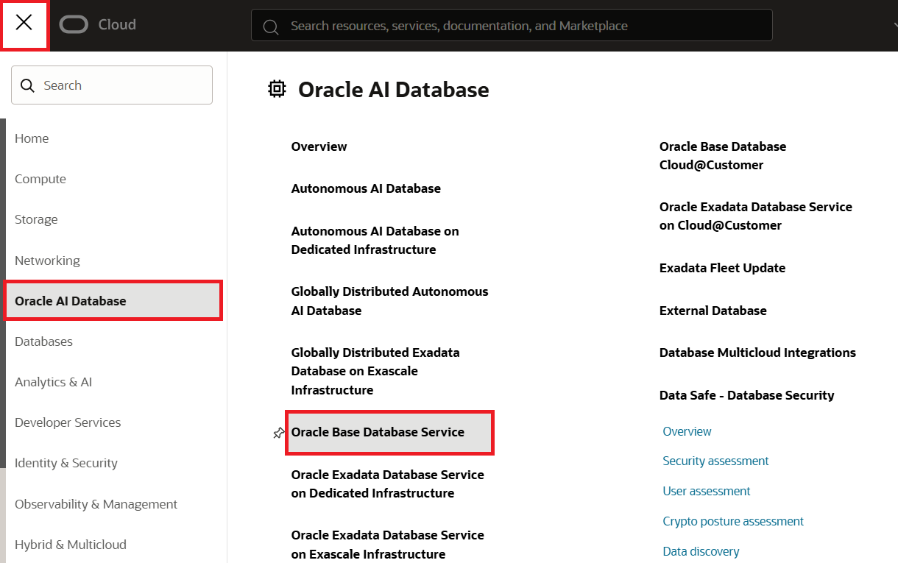

2. Select **Create DB System**.
    
   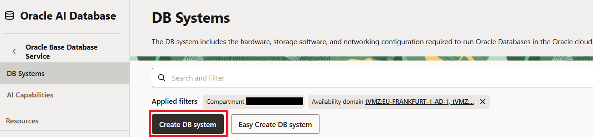

3. Make below selections on the **Create DB System** page.

   DB system name: **zdm-target-db** 
   
   Compartment: Ensure you have selected correct compartment for the DB system.

   Availability Domain: Leave it to default.

   Oracle Database software edition: **Enterprise edition**.
    
   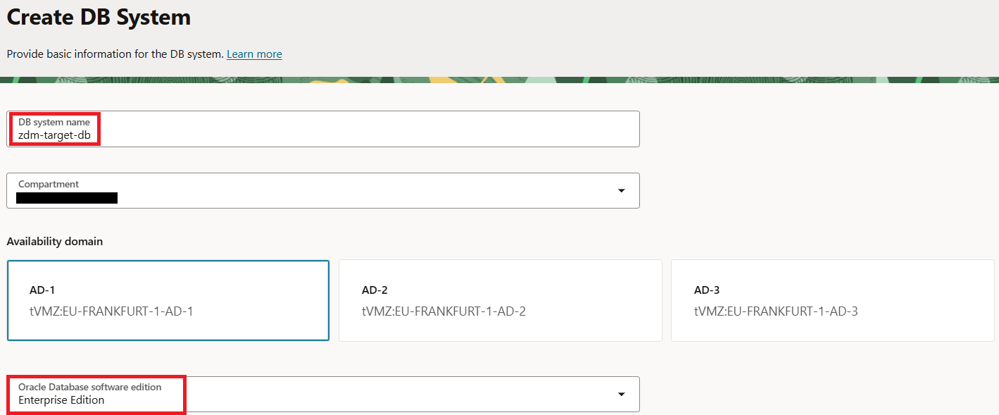

4. Selecting Shape.

   You can either leave the shape to the default one or modify it based on your requirement.

   We have left the shape to the default one for this workshop.

   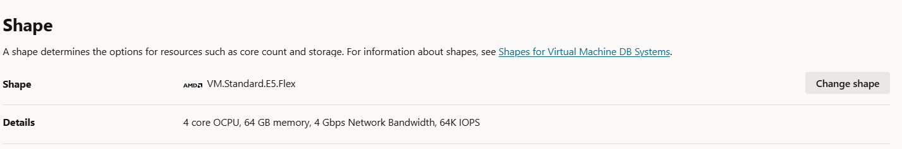

       
5. Configure storage.

   Select **Change Storage** as shown below.

   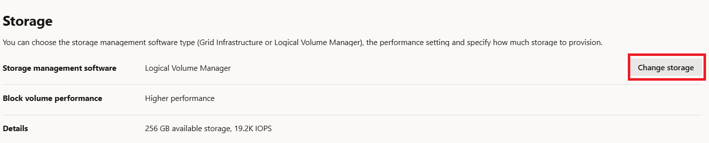

   Select **Oracle Grid Infrastructure** and **Balanced** option and click on **Save** as shown below.

   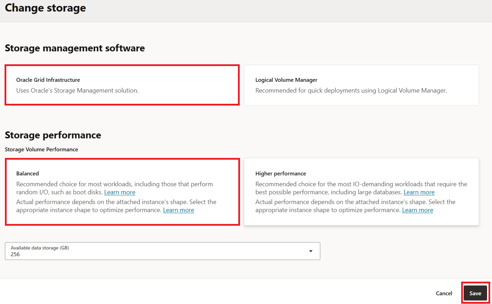

6. Configure DB System.

    Leave the DB System configuration to default.

   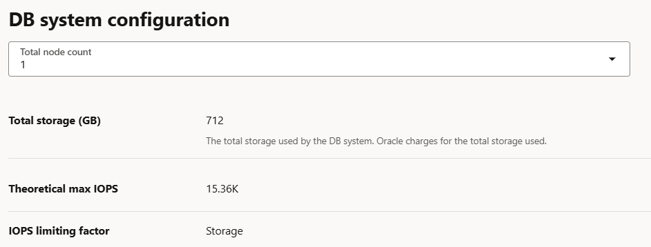

7. Upload SSH Keys.
   
   Under **SSH keys** , upload the SSH Public key generated in Lab 1.

   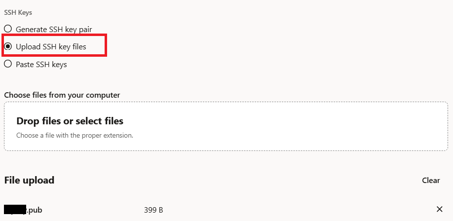

8. Select the appropriate License Type.

   Select appropriate license type applicable for you.

    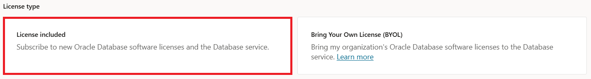

9. Specify below for the network information.

   Compartment: Compartment of VCN
   
   Virtual Cloud Network: **zdm-vcn**

   Compartment: Compartment of subnet which is same as the compartment for **zdm-vcn** for this lab.
   
   Client Subnet: **zdm-vcn-priv**

   Hostname prefix: **zdm-target-db**

   IPv4 address assignment: Automatically assign IPv4 address from subnet

    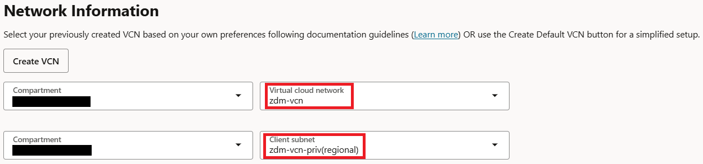

    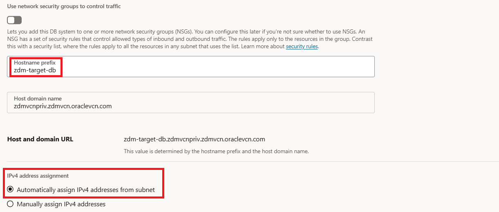

   Leave Diagnostic collection settings to default.

    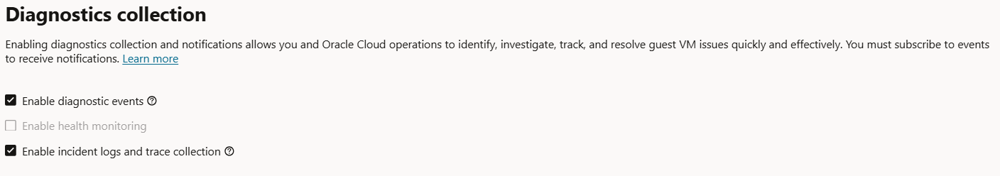

10. Provide database name.

    Specify the the same **DB\_NAME** as source database.

    Provide **Database name** as **ORCL** and **Database unique name suffix** as **T**.

     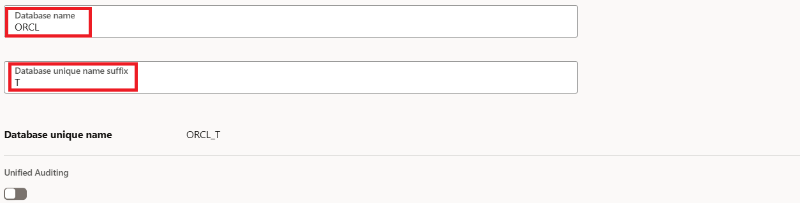

11. Select Database Image.

    Select  **Change Database Image** to bring up database software image selection screen.

    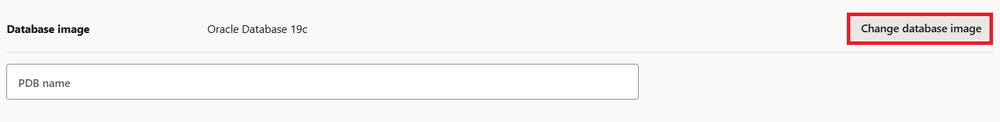

    Select **Custom Database Software images**.

    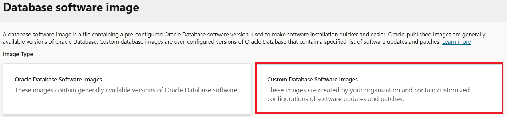

    Select the appropriate compartment and remove the **Database version 26ai** image filter shown in red rectangle below.

    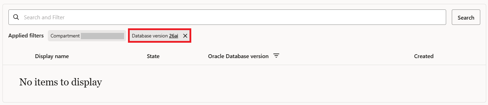

    Select the custom image created in task2 as below.

    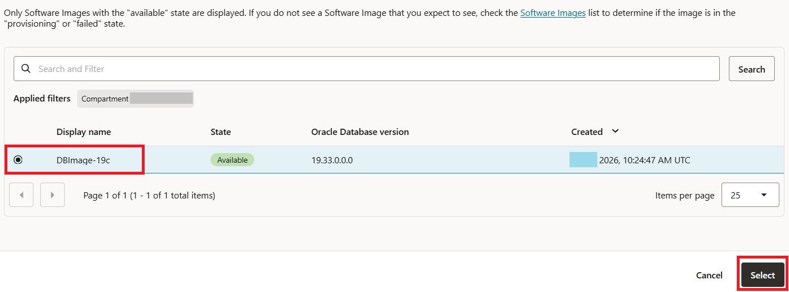

    Select **Select** to finalise the selection.

    Below selection will be reflected in original window.

     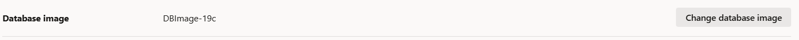

12. Provide Administrator credentials.

    Enter SYS password which is same as the SYS password of the source database.

     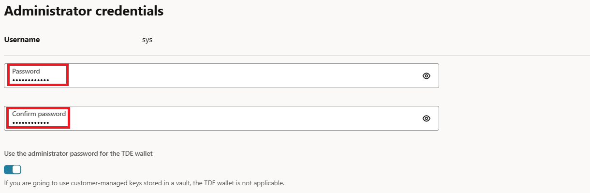

     Leave the TDE wallet password choice to the default.

13. Disable database backups.

    Uncheck the **Enable automatic backups** box to disable database backups.

    You don't need automatic backups until you complete the database migration.

    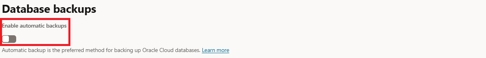

14. Select database charactetset.

    Expand **Advanced Options**

    Ensure that you have selected same database and national characterset as the source database.

    In this lab source database has below Database and National Characterset.

    Database Characterset : AL32UTF8

    National Characterset : AL16UTF16

    Sample output is shown below.

    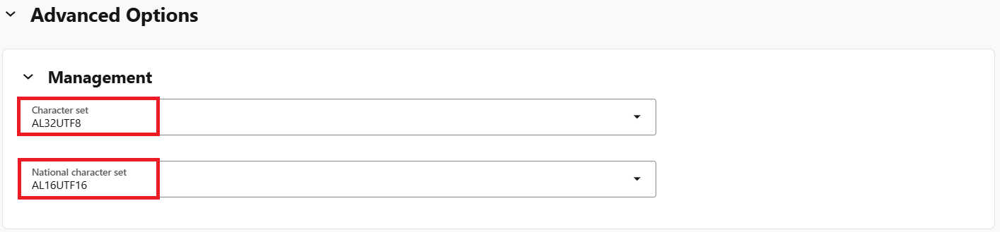

15. Start DB System provisioning.

    Select **Create** to initiate the DB system provisioning.

    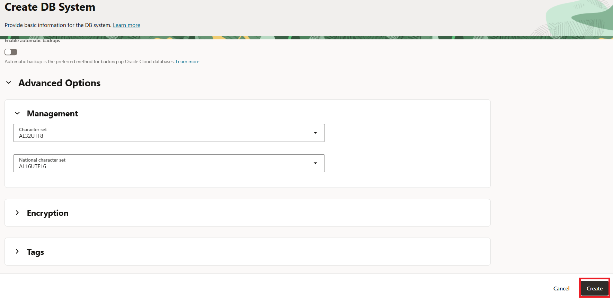

    This step is going to take up to 1 hour , however you can proceed to next lab while DB System is being provisioned.

You may now **proceed to the next lab**.

## Acknowledgements
* **Author** - Amalraj Puthenchira, Data Modernisation Black Belt, EMEA Technology Cloud Engineering
* **Last Updated By/Date** - Amalraj Puthenchira, November 2026


