# Provision target database

## Introduction

You create a placeholder target database before the start of the migration to the target environment. 

The placeholder target database gets overwritten during migration, but it retains the overall configuration.

Please note as of Zero Downtime Migration Release 21.3 , only Grid Infrastructure-based database services are supported as targets. For example, an LVM-based instance or an instance created in compute node without Grid Infrastructure are not supported targets.

You shouold use the control plane for the creation of a target placeholder database on Exadata Database Service on Dedicated Infrastructure and Exadata Cloud at Customer.

Estimated Time: 30 minutes

### Objectives

In this lab

* You will collect information from the source database required for target database provisioning.

* You will prepare a database software image for the target database.

* You will provision an Oracle Base Database VM to use as the target database system.

### Prerequisites

* All previous labs have been successfully completed.

## Task 1 : Collect Source Database Details

1. Check the Operating System version of the source database.

   For this lab we have deplopyed source database on Oracle Linux 8.

   You can use this lab with your source database , however ensure that the Operating System is Linux.

2. Establish connection to source database.

   Please follow below steps to establish connection to source database using SQLPLUS.

   Login to source database compute using Public IP and ssh key.

   Username to login : **opc** 

   Switch user to **oracle** using below command.

   **sudo su - oracle**

   Set the environment to connect to your database.

   Type **. oraenv** and press **Enter**. 
    
   Enter **ORCL** when asked for **ORACLE\_SID** and then press **Enter** (Enter your ORACLE\_SID in case if it is different).

   Type **sqlplus "/as sysdba"**  and press **Enter** to connect to source database as SYS user.

   Please find below snippet of the connection steps.

   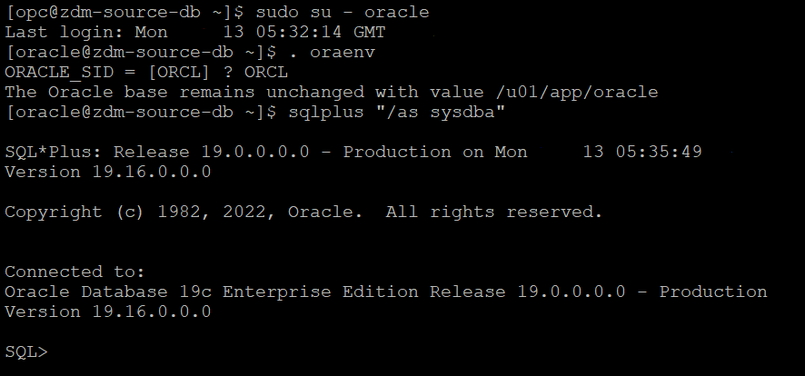

3. Check the database edition of the source database.

   The source database provisioned in this lab is an **Enterprise Edition** database since the Oracle Marketplace Image used for source database provisioning creates an Enterprise Edition database.

   In case you would like know the database edition for your on-premises database then refer the below steps.

   Execute the below query after connecting to source database using connection established in step 2.

    ```console
    <copy>
    select banner from v$version;
    </copy>
    ```
   
   You will receive an output similar to the one below which will have the Database Edition.

   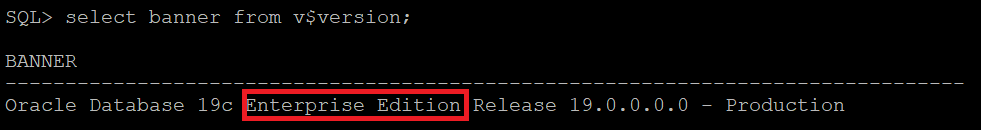

4. Check database characterset.
   
   Execute the below query after connecting to source database using connection established in step 2.
     
    ```console
    <copy>
    select PARAMETER,VALUE from nls_database_parameters where parameter like '%NLS%CHARACTERSET';
    </copy>
    ```
   
   In the query output **NLS\_CHARACTERSET** is the database characterset and **NLS\_NCHAR\_CHARACTERSET** is the national characterset.

   Sample output is shown below.

   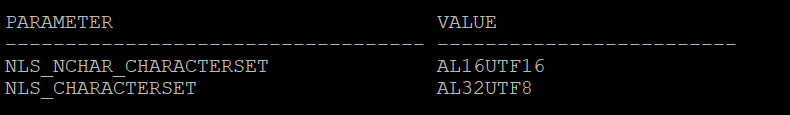

5. Check encryption algorithm.

   Check the **$ORACLE\_HOME\network\admin\sqlnet.ora** file in source database server to identify any encryption algorithm mentioned.

6. Generate patch inventory output.

   Execute below steps after logged into the source database system.

   Switch user to **oracle** using below command.

   **sudo su - oracle**

   Execute **opatch lsinventory** command.

   Below is sample trimmed output of the above command.

   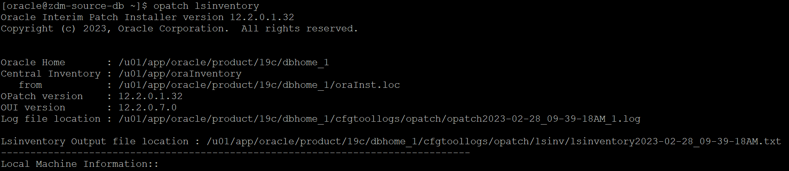

   Download the Lsinventory output file (location is shown in the output) to local desktop.


## Task 2 : Prepare Database Software Image for Target Database

1. Navigate to Oracle Base Database.

   Click the **Navigation Menu** in the upper left, navigate to **Oracle AI Database** and then select **Oracle Base Database Service**.

   

2. Select **Software images** on the left hand side of new screen.

   Select the appropriate compartment and then click on **Create software image** under **Software Images**.

   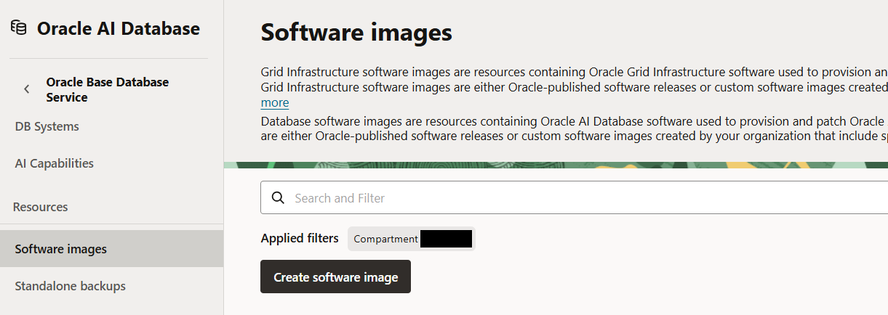

3. Make below selections on the **Create software image** page.

   Image Type: Database Software image

   Display name: **DBImage-19c**

   Compartment: Compartment of your choice

      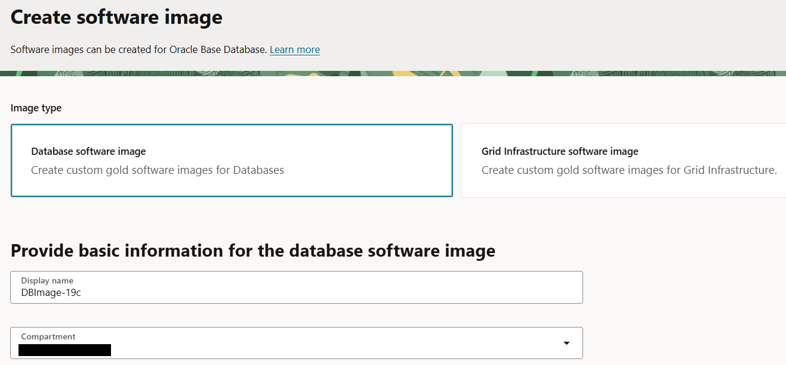

4. Make changes as below to configure database software image.

   Database version: 19c (same as the major version of your source database).

   Database Version Release Update: **19.33.0.0.0** ( Please ensure that you are selecting a version which is same or higher version than source database).

   Upload Oracle Home patch inventory output generated in earlier step (Task 1 step 6).

   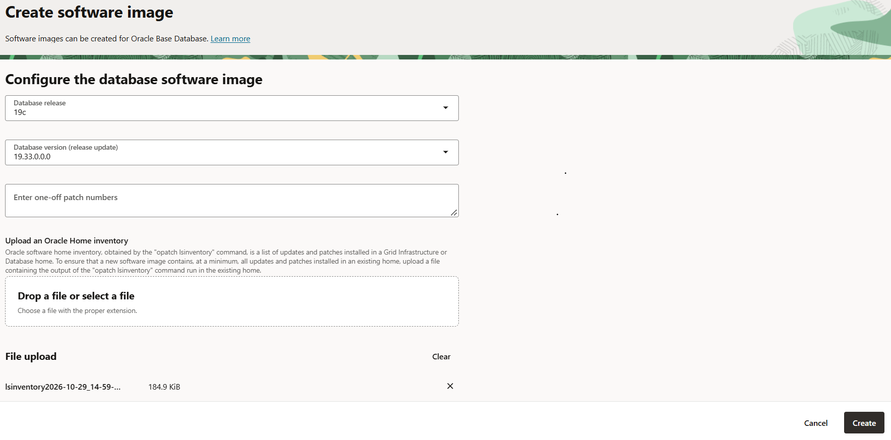

   Select **Create** to proceed with image creation.

   Please wait for the completion of this task before proceeding to the next task.
   
## Task 3 : Provision Target Database

1. Navigate to Oracle Base Database service.

   Click the **Navigation Menu** in the upper left, navigate to **Oracle AI Database** and then select **Oracle Base Database service** as shown below.

   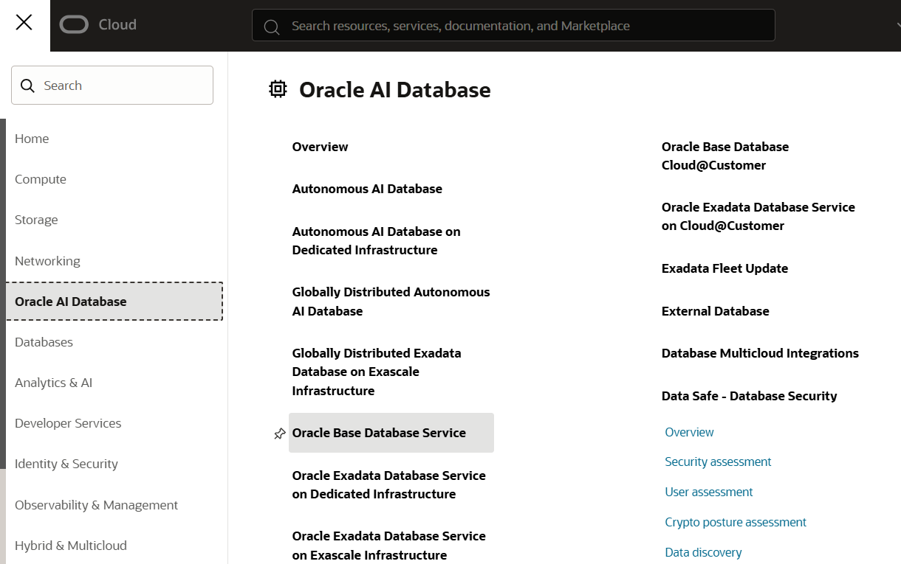

2. Click on  **Create DB System**.
    
   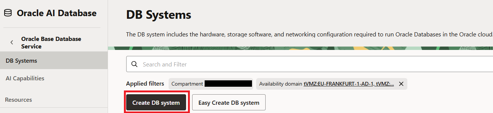

3. Make below selections on the **Create DB System** page.

   DB System name: zdm-target-db (Ensure you have selected correct compartment for the DB system)

   Availability Domain: Leave it to default

   Oracle Database Software edition: Enterprise edition.
    
   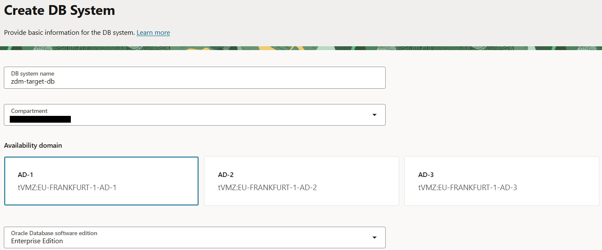

4. Selecting Shape.

   You can leave the Shape to the default one for this workshop.

   You also modify the shape for workshop if there are cost considerations.

   For Production work loads , choose the shape that meets your sizign requirement.

    
5. Configure storage.

   Select **Change Storage** as shown below.

   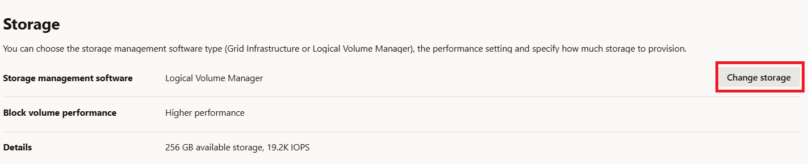

   Select **Oracle Grid Infrastructure** and **Balanced** option and click on **Save** as shown below.

   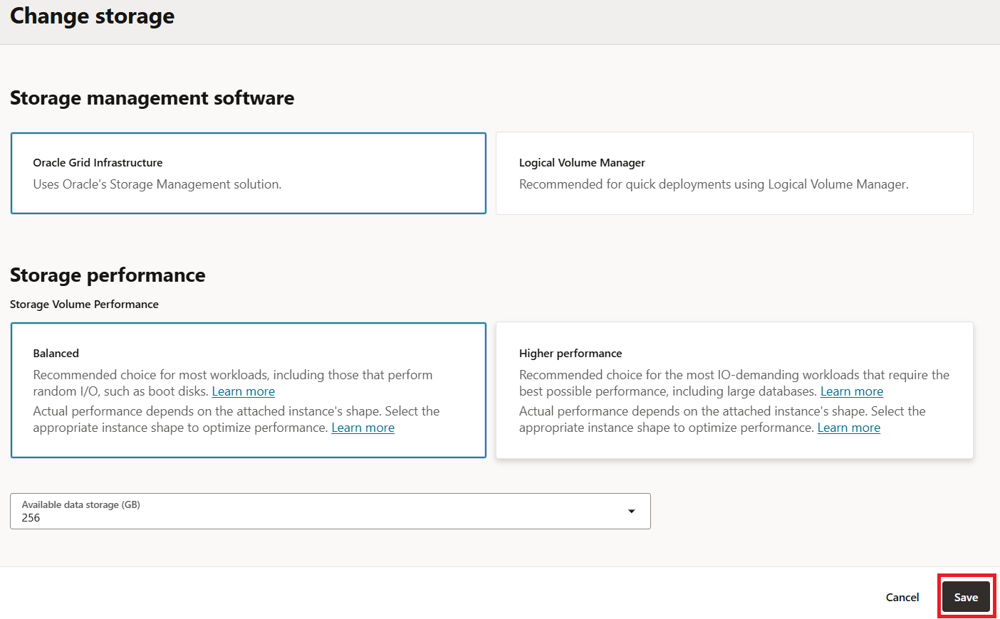

6. Configure DB System.

    Leave the DB System configuration to default.

   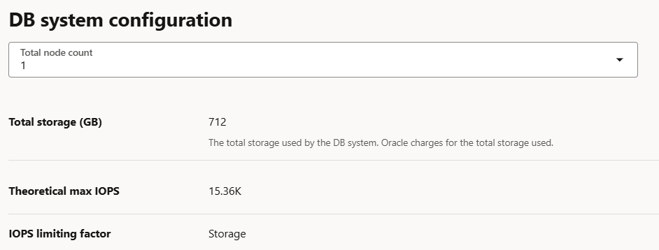

7. Upload SSH Keys.
   
   Under **SSH keys** , upload the SSH Public key generated in Lab 1.

   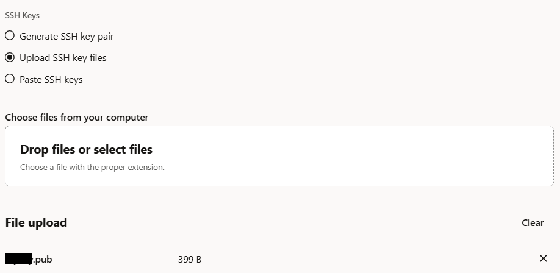

8. Select the appropriate License Type.

   Select appropriate license type applicable for you.

    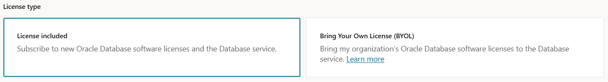

9. Specify the network information.

   Select **zdm-vcn** as Virtual Cloud Network and **zdm-vcn-priv** as Client subnet.

   Provide **zdm-target-db** as Hostname prefix.

   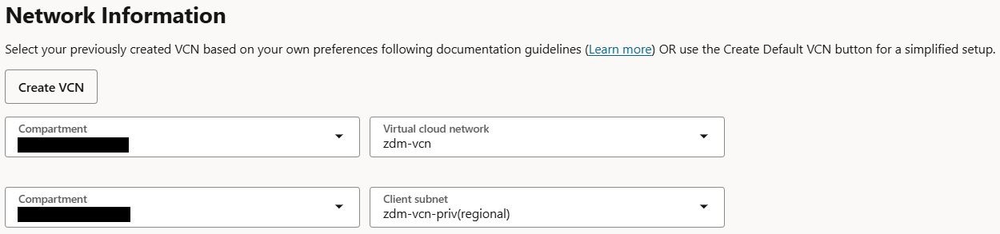

11. Click Next

    Click **Next** to go to the next page.

12. Provide database name.

   If the target database is Exadata Database Service on Dedicated Infrastructure or Exadata Cloud at Customer, then the target database **DB\_NAME** should be the same as the source database **DB\_NAME**.

   If the target database is Oracle Base Database VM , then the target **DB\_NAME** can be the same as or different from the source database **DB\_NAME**.

   Your target database is **Oracle Base Database VM** for this lab and you can keep the same **DB\_NAME** as source database for this lab.

   Provide **Database name** as **ORCL** and **Database unique name suffix** as **T**.

   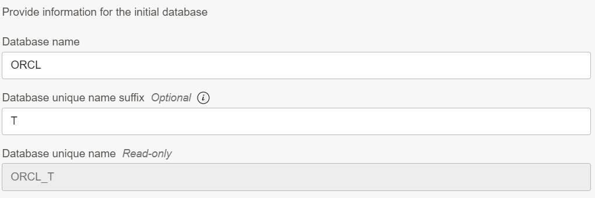

13. Select Database Image.

   Click on **Change Database Image** and select **Custom Database Software Images** as below.

   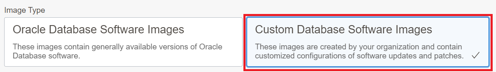

   Select the appropriate compartment and select DB Image created in previous task as below.

   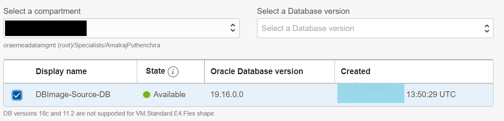

14. Provide SYS password.

   Enter SYS password which is same as the SYS password of the source database.

   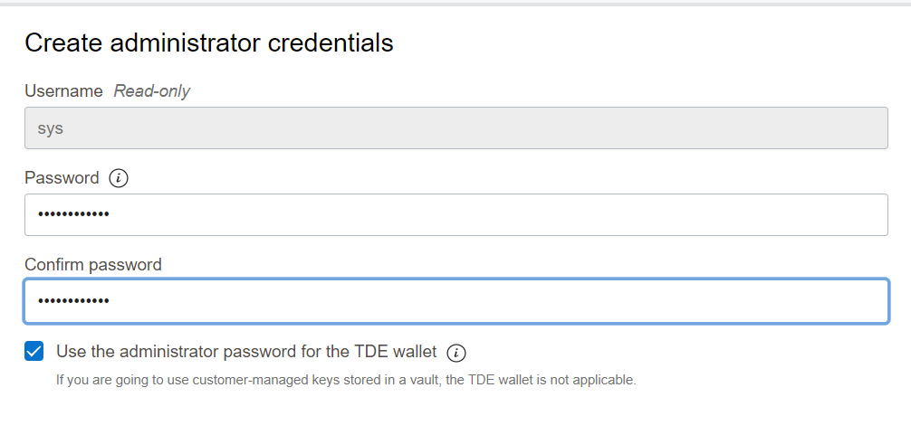

15. Select database workload type.

   In this lab , leave it to the default.

16. Disable database backups.

   Uncheck the **Enable automatic backups** box to disable database backups.

   You don't need automatic backups until you complete the database migration.

   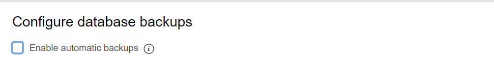

17. Select database charactetset.

   Click on **show advanced** options.

   Ensure that you have selected same database and national characterset as the source database.

   In this lab source database has below Database and National Characterset.

   Database Characterset : AL32UTF8

   National Characterset : AL16UTF16

   Sample output is shown below.

   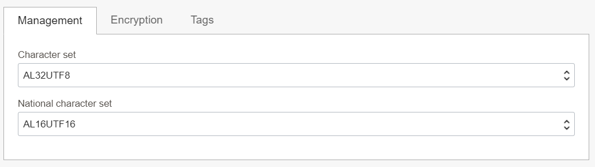

18. Start DB System provisioning.

   Click on the **Create DB System** to initiate the DB system provisioning.

   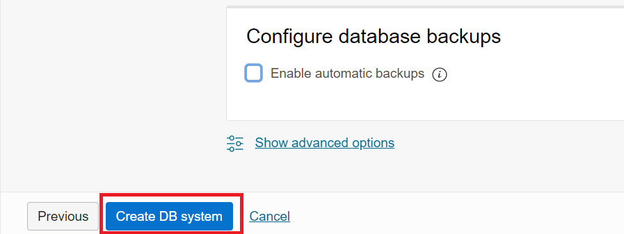

   This step is going to take up to 1 hour , however you can proceed to next lab while DB System is being provisioned.

You may now **proceed to the next lab**.

## Acknowledgements
* **Author** - Amalraj Puthenchira, Cloud Data Management Modernise Specialist, EMEA Technology Cloud Engineering
* **Last Updated By/Date** - Amalraj Puthenchira, April 2023


