# Provision and configure ZDM service host

## Introduction

Estimated Time: 45 minutes

### Objectives

In this lab

* You will provision a compute instance to use as ZDM servive host.
* You will configure ZDM software on the compute instance.

### Prerequisites

* All previous labs have been successfully completed.

## Task 1 : Provision ZDM compute instance

1. Navigate to compute instance in OCI Console.

   Click the **Navigation Menu** in the upper left, navigate to **Compute** and then select **Instances**.

   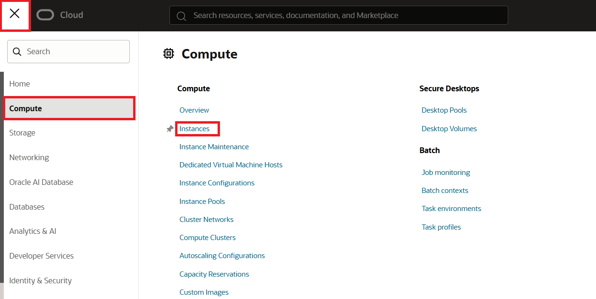

2. Select **Create Instance**.

   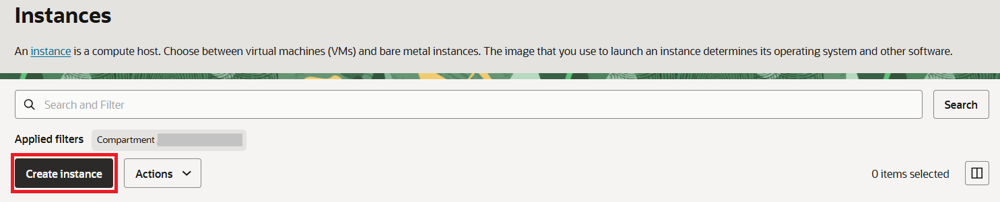

3. Provide basic information.

   Name: **zdm-host** 
   
   Create in compartment: **select appropriate compartment**

   Placement: Leave it to default

   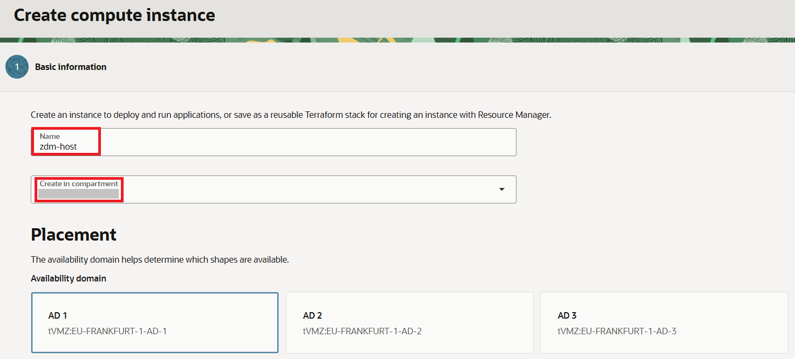

  4. Image selection.

     Under **Image and Shape** , select **Change image**.

     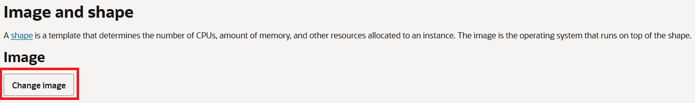

     Select **Oracle Linux**

     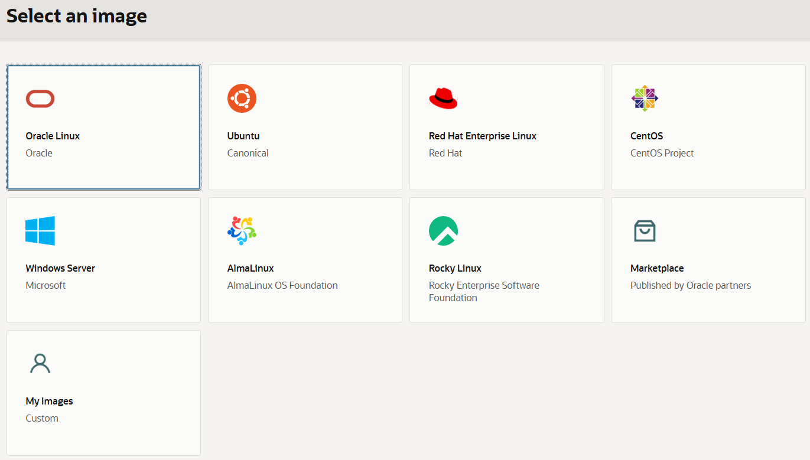

     Select **Oracle Linux 8**

      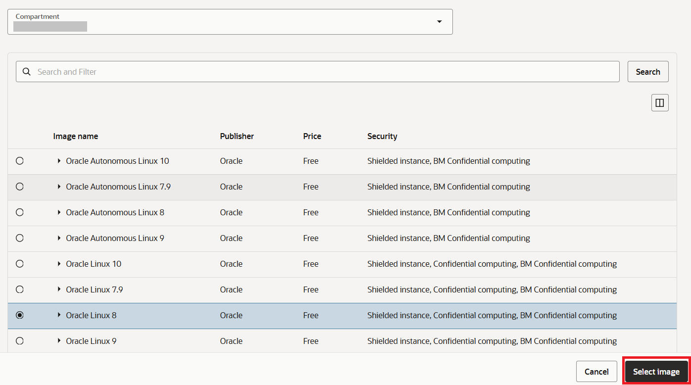

      Finalize the image by selecting **Select image**

5. Shape selection.

   You can either leave the **Shape** to default one or choose another one based on your requirement.

   Below is the detault selection.

     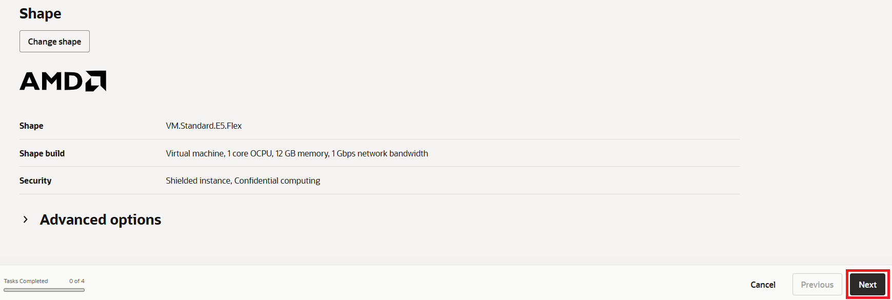

   Select **Next** to proceed to **Security**.

6. Security configuration.

   Leave security configuration to default.

    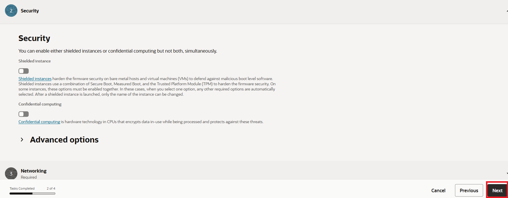

   Proceed to **Networking** by selecting **Next**.

7. Networking configuration.

   Make below selections.

   Primary network: **Select existing virtual cloud network**

   Virtual cloud network compartment: Compartment for **zdm-vcn**

   Virtual Cloud Network: **zdm-vcn**

   Subnet compartment: Compartment of subnet **zdm-vcn-priv** (same as the **zdm-vcn** compartment for this lab)

   Subnet: **zdm-vcn-priv(regional)**
   
   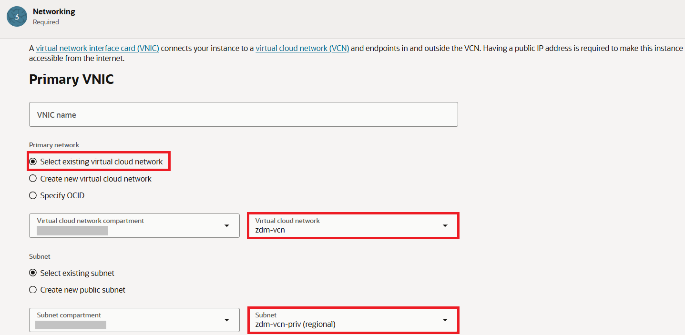
  
   Leave the Private and Public IP assignment to default.

   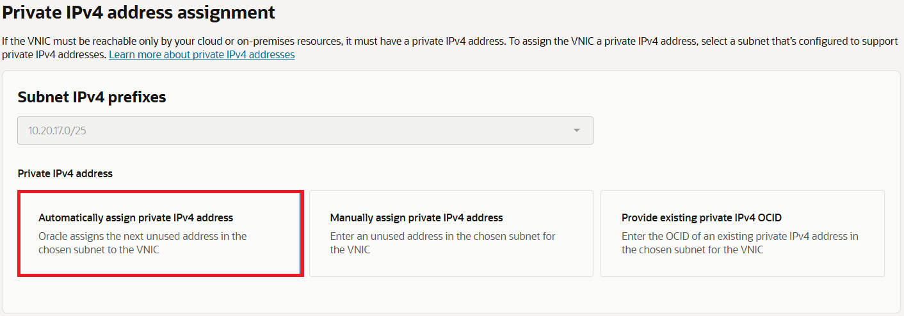

   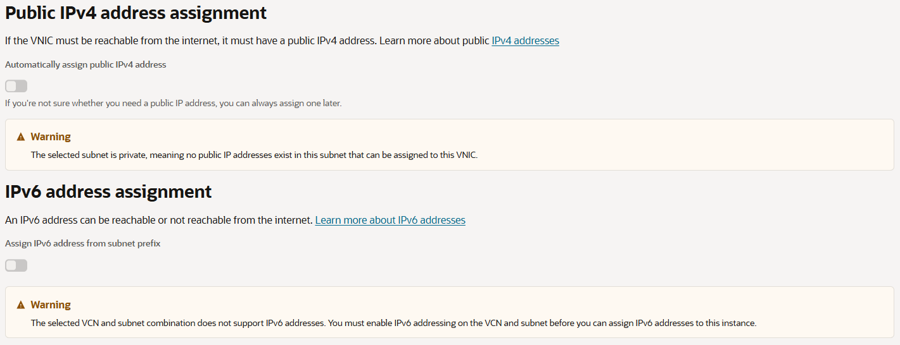

   Under **Add SSH keys** , upload the public ssh key generated in Lab 1.

   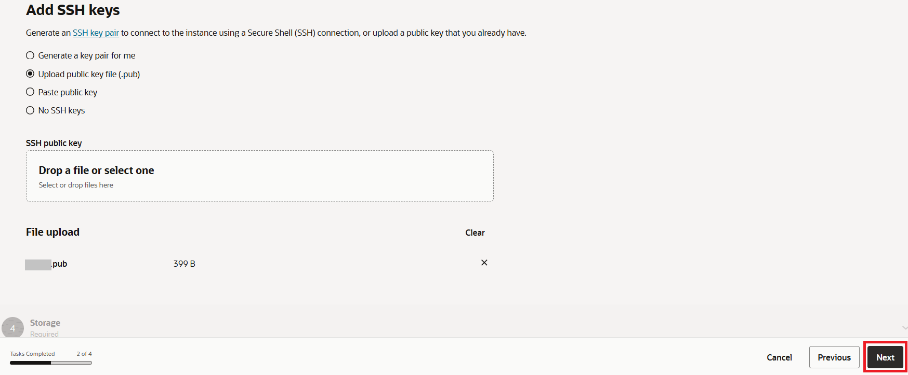

   Proceed to **Storage** by selecting **Next**.

8. Specify custom boot volume.

   Under **Boot volume** , Enable **Specify a custom boot volume size and performance setting** and specify **100** for **Boot volume size**.

   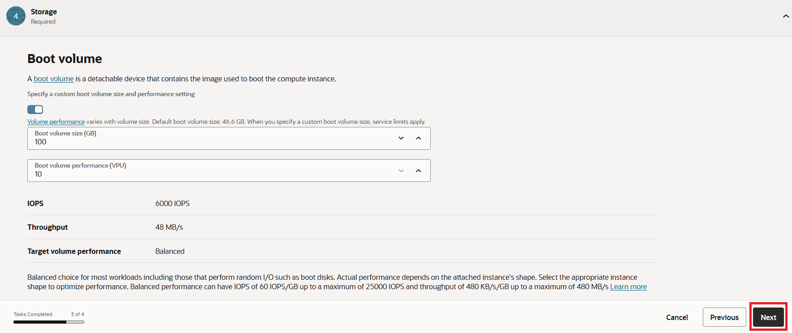

    Proceed to **Review** by selecting **Next**.
   
9. Review configuration.

   Review the details and proceed with compute creation by selecting **Create**.

   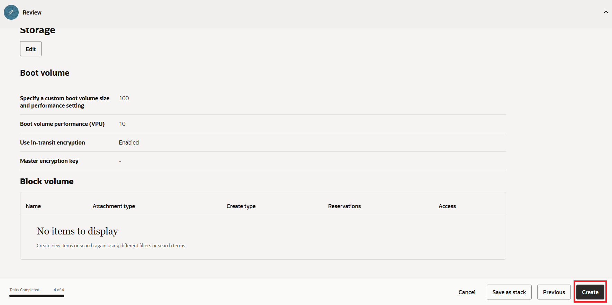

   In less than a few minutes ZDM compute instance will be provisioned.

## Task 2 : Configure ZDM service

1. Obtain private IP of ZDM host.

   Click the Navigation Menu in the upper left, navigate to Compute and then select Instances.

    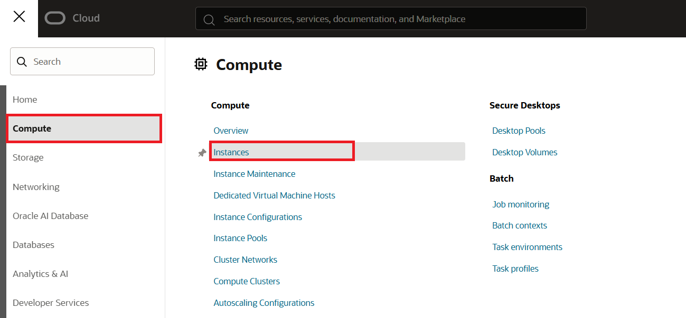

   Make a note of the private ip of **zdm-host**.

    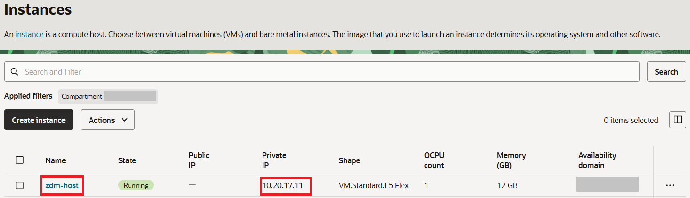

2. Login to ZDM host using the private IP and ssh key file.

   Use a command similar to below to access the zdm-host from cloud shell or from a host which has access to **zdm-vcn**.

    ```text
     <copy>
     ssh -i <private-key> opc@<private_ip>
     </copy>
     ```

3. Perform latest OS updates.

   It is recommended to perform update of all available packages.

   Execute below command.

     ```text
      <copy>
      sudo dnf update -y
      </copy>
     ```
   
   Below is sample output (truncated).

   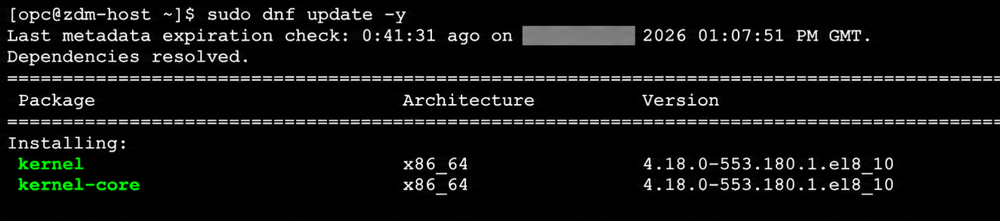

4. Expand the root FS.

   Execute below command as **opc** user and **press y and Enter** when asked.

   **sudo /usr/libexec/oci-growfs**

   You will see an output(truncated) similar to the one below.

   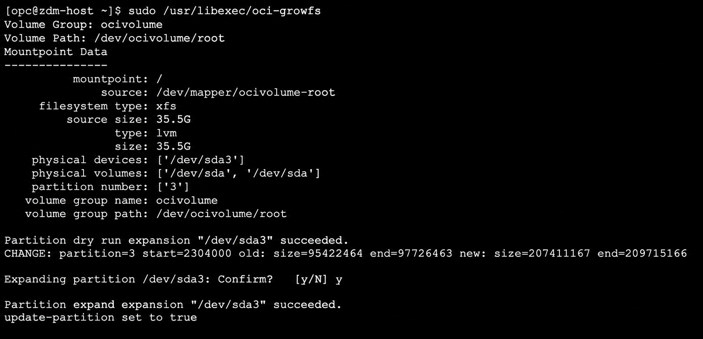

5. Install required packages.

   Execute the below command to install required packages for ZDM.

     ```text
     <copy>
     sudo dnf install -y oraclelinux-developer-release-el8 \
     libnsl \
     perl \
     unzip \
     glibc-devel \
     expect \
     libaio \
     ncurses-compat-libs \
     ncurses-devel \
     numactl-libs \
     openssl \
     mlocate \
     bind-utils
     </copy>
     ```
     You will receive an output(truncated) similar to the one below. 

     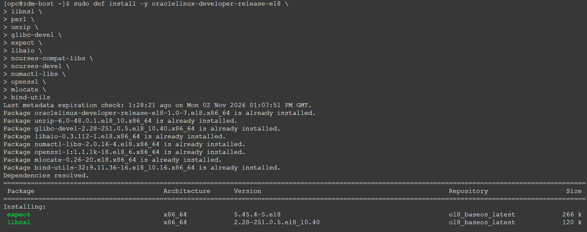

6. Create user, group and directories required for ZDM.

   Switch to **root** user using below command.

   **sudo su -**

   Execute below commands.

     ```text
     <copy>
     groupadd zdm
     useradd -g zdm zdmuser
     mkdir /home/zdmuser/zdmhome
     mkdir /home/zdmuser/zdmbase
     chown zdmuser:zdm /home/zdmuser/zdmhome
     chown zdmuser:zdm /home/zdmuser/zdmbase
     </copy>
     ```
7. Download ZDM software.

   Download the ZDM software from below URL.

   https://www.oracle.com/database/technologies/rac/zdm-downloads.html

8. Upload ZDM software to ZDM host.

   Upload the software(.zip file) to /tmp directory in ZDM host.

   Ensure that all users can read the .zip file.

9. Unzip the ZDM software.

   Login to **zdm-host** using private IP and key file.
   
   Switch user to **zdmuser** using below command.

   **sudo su - zdmuser**
   
   Unzip the ZDM software under /tmp directory.

   Below is sample output.

     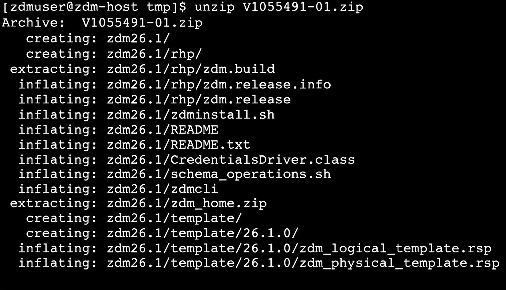

   Note down the directory path of unzipped folder , it will be **/tmp/zdm26.x** for **ZDM 26.x** , Please note this is a generic placeholder name for ZDM software and make sure to use the latest version available.

10. Install ZDM software.

    Change directory to ZDM software unzipped location using below command.

    cd /tmp/zdm26.x
   
    Execute the below command to install ZDM software.
   
     ```text
     <copy>
     ./zdminstall.sh setup oraclehome=/home/zdmuser/zdmhome oraclebase=/home/zdmuser/zdmbase ziploc=/tmp/zdm26.x/zdm_home.zip
     </copy>
     ```
     This will take couple of minutes.

     Below is sample output.
     
    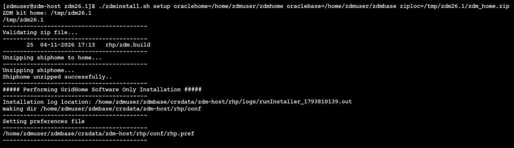


     You will see output as below when ZDM service setup has been completed.

    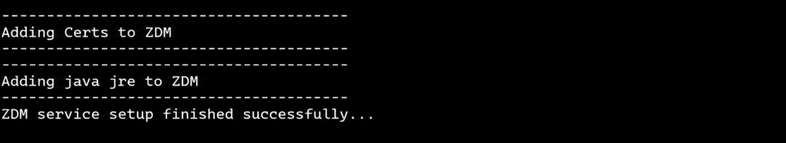

11. Start ZDM service.

    Navigate using below command.

    **cd /home/zdmuser/zdmhome/bin**

    Execute below command to start ZDM.

    **./zdmservice start**

    Below is sample output.

    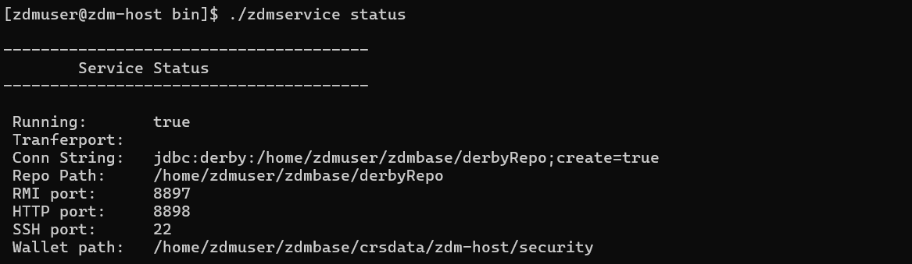

12. Check ZDM service status.

    Execute below command to see the ZDM servive status.

    **./zdmservice status**

    Sample output is given below.

    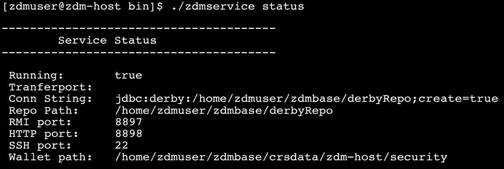

    You have successfuly installed ZDM software , please proceed to next task.

## Task 3 : Configure SSH connectivity from ZDM host to source and target database servers

   Please follow the below steps to enable SSH connectivity from ZDM service host to source and target DB system.

1. Allow incoming connection on port 22 for source and target database subnet.

   You have deployed source database , target database and ZDM service host into the same private subnet for the purpose of this lab.

   You need to ensure that incoming connection on port 22 is not blocked on Subnet level.

   No action needs to be taken for this lab since port 22 is already open by default for the private subnet configured in this lab.

   However, you may need to take care of opening port 22 if your source and target deployment is different compared to the one specified in this lab.

2. Enable source and target database system hostname resolution from ZDM service host.

   ZDM requires hostname resolution for source and target database servers.

   This is typically accomplished by adding the respective hostname and IP address of source and target to the **/etc/hosts** file of ZDM service host.

   You don't have to do this for this lab since all the components are in same VCN.  
  
3. Copy the private SSH key to ZDM host.

   Copy the SSH private key generated in lab 1 to ZDM service host under **zdmuser** home (/home/zdmuser).

   Please note that you are using same private key and public key pair for source database compute , target DB System and ZDM host in this lab.

   If you have different private keys for source and target database systems then you have to copy both of them to ZDM service host.

   Change the permission of private key as below.

   chmod 600 **key\_file\_name**

4. Verify SSH connectivity from ZDM servive host to source and target DB system.

   i. Execute the below command to test the ssh connectivity from ZDM service host to source database system.

   **ssh -i key\_file\_name opc@zdm-source-db**

   Enter **yes** for below question.
   
   **Are you sure you want to continue connecting?**

   You will be logged in to the source DB system if the connectivity is successful as shown below.

   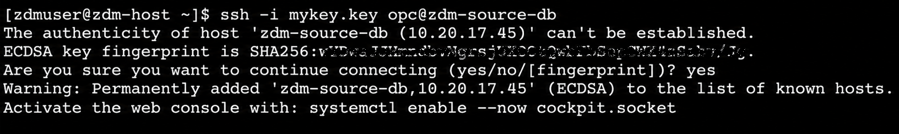

   Enter **exit** to come out of source db server.

   ii. Execute the below command to test the ssh connectivity from ZDM service host to target database system.

   **ssh -i key\_file\_name opc@zdm-target-db**

   Enter **yes** for below question.
   
   **Are you sure you want to continue connecting?**

   You will be logged in to the target DB system if the connectivity is successful as shown below.

   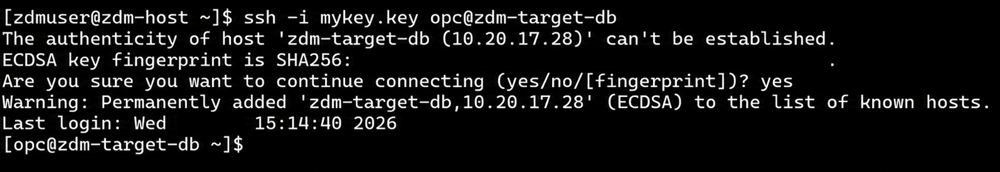


You may now **proceed to the next lab**.

## Acknowledgements
* **Author** - Amalraj Puthenchira, Data Modernisation Black Belt, EMEA Technology Cloud Engineering
* **Last Updated By/Date** - Amalraj Puthenchira, November 2026


